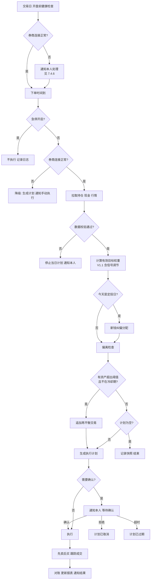

# 定投动态再平衡系统 · 产品设计书

| 项目 | 内容 |
| --- | --- |
| 版本 | v0.6.5 |
| 日期 | 2026-10-26 |
| 状态 | **评审稿**。策略研究工具（V0.5，第 5.9–5.12 节）已有可用原型；执行系统（V1.0/V1.1）的产品行为与 IBKR、嘉信适配已定义，第 7.4.5 节列出的接口能力须在 P0 实测确认后再开发对应部分 |
| 阅读对象 | 产品负责人（你本人）、实现者 |
| 适用范围 | 策略研究工具：面向上班族（是否对他人开放见 D-08）；执行系统：个人自用，支持 IBKR 与嘉信（Charles Schwab），同一时间只启用一个券商账户 |
| 原型 | [衡 · 定投再平衡](https://claude.ai/artifact/JgZ1K7iQFTcHBkiVtKiVXJ)（私有链接）；源文件 `app/src.html`，数据 `app/data/prices-weekly.json` |

> 本文所有比例、阈值、标的组合均为**可配置项的默认值或测试数据**，不构成投资建议。

信息标注口径：**【已确认】** 用户明确说过；**【建议】** 产品设计建议；**【假设】** 工作假设，可推翻；**【待决策】** 见第 11 节。

---

## 1. 产品结论

**产品由两部分组成，按顺序交付**：
1. **策略研究工具（V0.5，不连券商）**：帮上班族选标的、定配置、看历史，并在每月发薪后告诉他该买什么、买多少。以**动态再平衡**页为主页，另有标的库、定投模型（模板与配置）、AI 配置草案、2000 年至今的回测（第 5.9–5.13 节）。已有可用原型。
2. **执行系统（V1.0/V1.1，连券商）**：把选定的策略每月自动执行下去，下文第 1–5.8 节和第 7.4 节描述的就是这部分。研究工具里确定的权重和再平衡规则，是执行系统的输入。

执行系统的一句话描述：一个只服务你自己的程序，按你设定的分层资产池和目标权重定期投入，优先用新钱纠正权重偏离，偏离超限时自动生成并执行再平衡交易，可叠加均线类市场信号调节投入金额和权重，全程留痕、可急停。

**首版如何运作**：
1. 你在配置里定义资产池（高/中/低风险三层）、目标权重、定投金额和周期。
2. 每个交易日系统读取持仓和行情；定投日把可用现金按"缺口"分配给低配资产（新钱纠偏）。
3. 若任一资产偏离超出阈值，系统生成"卖高配、买低配"的再平衡计划。
4. 计划按执行策略自动下单或推送给你确认，成交后对账、记日志、更新报表。
5. V1.1 起可开启市场信号：按价格相对长期均线调节当期投入倍数、对高风险资产做有限的趋势减配。

**关键取舍**：

| 取舍 | 选择 | 理由 |
| --- | --- | --- |
| 纠偏方式 | 新钱纠偏优先，超阈值才卖出 | 少交易、少税费；M1 Finance、Passiv、Betterment 均如此（调研结论） |
| 触发方式 | 每日检查 + 阈值触发 + 冷却期 | 兼顾及时性与换手；纯定期会错过大偏离，纯阈值在比特币上会过度频繁 |
| 卖出是否全自动 | 默认买入自动、卖出需确认 | 卖出不可逆且涉及税务；你可在设置中改为全自动 |
| 信号调节 | 放在 V1.1，且启用前须有对应参数的回测记录 | 先让最小闭环稳定跑起来；信号最容易因参数过拟合出问题 |
| 比特币 | 通过现货比特币 ETF 持有【已确认：全在一个美股券商】 | 单账户、统一交易时段、统一对账 |
| 券商 | IBKR 与嘉信都适配，统一适配层，同一时间只启用一个账户【已确认：两家都做】 | 规则只写一套；两家都需要周期性人工认证，因此设计了到期提醒和"降级为手动执行" |

---

## 2. 背景、用户与目标

### 2.1 问题
- 手动定投多资产时，每期都要算"这笔钱该分给谁"，容易拖延或凭感觉。
- 资产涨跌后权重漂移，高风险资产（纳指、比特币）会逐渐占比过高，风险超出预期。
- 想引入"动态"调节，但人工执行规则不稳定，也无法事后复盘规则是否有效。

### 2.2 用户与场景
- **策略研究工具**【已确认：针对上班族，2026-10-26】：有稳定月薪、每月发薪后有结余、没有时间盯盘的上班族。他们要回答三个问题：买哪些标的、各买多少、这样配过去表现如何。当前原型只有你本人能打开，是否对他人开放见 D-08。
- **执行系统**【已确认：自用】：唯一用户是你本人，同时是配置者、确认者、审阅者。下表是执行系统的场景。

| 场景 | 频率 | 期望 |
| --- | --- | --- |
| 定投日自动投入 | 按周期（默认每月） | 无需操作或一键确认 |
| 市场大波动后 | 不定期 | 偏离超限自动提示/纠偏 |
| 看整体情况 | 每周/每月 | 一页看清持仓、偏离、真实收益 |
| 调整策略 | 每季或更少 | 改参数前能回测对比 |
| 紧急情况 | 极少 | 一键停止全部自动交易 |

### 2.3 成功指标【建议目标，基线未知】

| 指标 | 定义 | 目标 |
| --- | --- | --- |
| 定投准时率 | 应执行定投期数中，在定投日当天完成（或按规则顺延完成）的占比 | 100% |
| 权重受控率 | 每日收盘快照中，所有资产均在阈值带内的天数占比（剔除冷却期） | ≥ 95% |
| 错误交易数 | 非计划、重复、超限额的成交笔数 | 0 |
| 人工耗时 | 每月花在定投/再平衡操作上的时间 | ≤ 10 分钟 |

---

## 3. 范围与需求台账

### 3.1 范围

- **V0.5 策略研究工具（Must，已有原型）**：标的库、策略模板与配置、AI 配置草案、回测。不连券商、不下单。
- **V1.0（Must，最小闭环）**：资产池与权重配置、定投计划、新钱纠偏、阈值再平衡、自动下单与确认、安全限额与急停、模拟运行、对账与日志、总览与收益报表、通知。
- **V1.1（Should）**：均线投入倍数信号、趋势减配信号，以及"开/关信号"的回测对比。
- **后续候选（Later）**：估值类信号（市盈率等，需可靠数据源）、波动率目标、多账户、税务优化（税损收割）。
- **明确不做**：执行系统的多用户/对外服务、托管他人资金、以投资建议名义输出配置（研究工具的 AI 草案只作学习参考，是否对他人开放见 D-08）、杠杆与期权、比特币现货与交易所对接。

### 3.2 需求台账

| ID | 需求 | 来源 | 优先级 | 版本 | 设计位置 |
| --- | --- | --- | --- | --- | --- |
| REQ-001 | 分层资产池（高/中/低风险）及目标权重 | 用户原话 | Must | V1.0 | 5.1 |
| REQ-002 | 定期定投 | 用户原话 | Must | V1.0 | 5.2 |
| REQ-003 | 动态再平衡（偏离纠正） | 用户原话 | Must | V1.0 | 5.3 |
| REQ-004 | 自动下单 | 已确认 | Must | V1.0 | 5.4 |
| REQ-005 | 单一美股券商，比特币用 ETF | 已确认 | Must | V1.0 | 7.2 |
| REQ-006 | 固定权重 + 市场信号调节两者都要 | 已确认 | Must（固定）/ Should（信号） | V1.0 / V1.1 | 5.3 / 5.7 |
| REQ-007 | 执行系统仅自用（研究工具面向上班族，见 REQ-019 起） | 已确认 | — | — | 全文边界 |
| REQ-008 | 模拟运行（不真实下单） | 建议 | Must | V1.0 | 5.5 |
| REQ-009 | 限额、价格保护、急停 | 建议（自动下单的必要配套） | Must | V1.0 | 5.5 |
| REQ-010 | 通知与确认 | 建议 | Must | V1.0 | 5.6 |
| REQ-011 | 对账与审计日志 | 建议 | Must | V1.0 | 5.4 / 7.1 |
| REQ-012 | 收益报表（资金加权收益率 XIRR、回撤） | 建议（调研：避免收益口径误导） | Must | V1.0 | 5.8 |
| REQ-013 | 分红与入金作为新现金参与纠偏 | 建议 | Must | V1.0 | 5.2 |
| REQ-014 | 回测：2000 年至今，策略净值与各标的 K 线、基准对比 | 用户原话（2026-10-26；原为建议、排在 V1.1） | Must | V0.5 | 5.9 |
| REQ-015 | 接入 IBKR | 用户原话 | Must | V1.0 | 7.4.3 |
| REQ-016 | 接入嘉信 | 用户原话 | Must | V1.0 | 7.4.4 |
| REQ-017 | 统一券商适配层，屏蔽两家差异 | 建议（REQ-015/016 的实现前提） | Must | V1.0 | 7.4.1–7.4.2 |
| REQ-018 | 券商授权到期提醒、断线处理与降级为手动执行 | 建议（两家都需周期性人工重新认证） | Must | V1.0 | 7.4.6 |
| REQ-019 | 确认用户提出的五个标的是否适合，并推荐其他适合的标的 | 用户原话 | Must | V0.5 | 5.10.1 |
| REQ-020 | 标的库：持仓说明、风险程度、过去 20 年平均年化、点击查看历史 K 线、可选入组合 | 用户原话 | Must | V0.5 | 5.10 |
| REQ-021 | 基本策略：稳健、均衡、激进等 | 用户原话 | Must | V0.5 | 5.11.1 |
| REQ-022 | 自定义配置：调整权重与再平衡规则 | 用户原话（"可以做选择配置的"） | Must | V0.5 | 5.11.2 |
| REQ-023 | AI 根据年龄、家庭、期望回报、风险承受、偏好、月薪等生成方案 | 用户原话 | Must | V0.5 | 5.12 |
| REQ-024 | AI 方案的安全校验与回测检验 | 建议（REQ-023 的必要配套） | Must | V0.5 | 5.12.4 |
| REQ-025 | AI 不可用时的规则推荐 | 建议 | Must | V0.5 | 5.12.6 |
| REQ-031 | 标的库加入上证指数、中证 A500、华宝银行 ETF（512800）、央企红利 ETF（561580）、创业板、恒生指数、恒生科技 | 用户原话（2026-10-26） | Must | V0.5 | 5.10.1、5.10.3 |
| REQ-027 | 主页为动态再平衡页：按定投模型显示持仓与比例 | 用户原话（2026-10-26） | Must | V0.5 | 5.13.2 |
| REQ-028 | 本月新增资金怎么分：每个标的买多少、卖多少 | 用户原话 | Must | V0.5 | 5.13.3 |
| REQ-029 | 结合当前市场情况与预期解读持仓 | 用户原话 | Must | V0.5 | 5.13.4 |
| REQ-030 | 整体体验走查：直观、逻辑清晰、简单好用 | 用户原话 | Must | V0.5 | 附：体验走查 |
| REQ-026 | 专业、高级、简约的界面，带线条图案；2026-10-26 改为参照 Skill Cabinet 的纸感线条风（暖纸底 + 陶土色），取代先前"不用暖白加陶土色"的要求 | 用户原话 | Must | V0.5 | 6.1 |

---

## 4. 角色、模块与全局流程

### 4.1 角色
只有一个角色"本人"，拥有全部权限。系统自身作为"调度器"执行定时任务，其能做的事受第 5.5 节限额与执行策略约束。

### 4.2 模块

```
配置中心（资产池/策略/定投/执行策略/限额）
      │
调度器 ──► 数据采集（持仓、现金、行情、历史价格）
      │
计划引擎（信号计算 → 有效目标权重 → 纠偏/再平衡计算）
      │
执行器（确认 → 下单 → 跟踪成交 → 对账）
      │
报表与通知 ◄── 审计日志
```

### 4.3 每日运行主流程



### 4.4 执行计划状态

| 状态 | 进入条件 | 可转向 |
| --- | --- | --- |
| 待确认 | 计划含需确认的交易 | 已批准、已取消、已过期 |
| 已批准 | 本人确认，或无需确认 | 执行中 |
| 执行中 | 开始提交订单 | 已完成、部分完成、失败 |
| 已完成 | 所有订单全部成交 | — |
| 部分完成 | 有订单未成交/被拒，且已达重试上限 | — （剩余部分在下一交易日重新计算，不续用旧计划） |
| 失败 | 首笔订单即被拒、券商连接失败或触发安全停止 | — |
| 待手动执行 | 下单时券商不可用，进入降级模式（7.4.6） | 已完成（下一次快照确认持仓已变化）、已过期 |
| 待核对 | 出现"结果未知"的订单（7.4.2） | 你核对后标记为已完成 / 部分完成 / 失败 |
| 已取消 | 本人拒绝，或急停时尚未执行 | — |
| 已过期 | 确认截止时间（默认收盘前 30 分钟）仍未确认 | — |

非法操作：已进入"执行中"的计划不能再被修改，只能急停；终态计划不可重新执行，只能由下一次运行重新生成。

### 4.5 订单状态
待提交 → 已提交 → 部分成交 → 已成交；已提交/部分成交 → 已撤单（超时撤单或急停）；待提交/已提交 → 被拒。

---

## 5. 功能详细设计

### 5.1 资产池与目标权重（REQ-001）

**配置项**（每个资产一行）：

| 字段 | 类型 | 必填 | 规则 |
| --- | --- | --- | --- |
| 代码 | 文本 | 是 | 必须能在券商查询到报价；重复代码报错 |
| 风险层级 | 高/中/低 | 是 | 决定默认阈值 |
| 目标权重 | 百分比，0.1% 精度 | 是 | 所有资产合计必须等于 100%，否则不能保存 |
| 权重下限/上限 | 百分比 | 否 | 仅供 V1.1 信号调节使用；默认等于目标权重（即不允许调节） |
| 绝对偏离阈值 | 百分点 | 否 | 默认：高风险 5，中/低风险 3【建议】 |
| 相对偏离阈值 | 百分比 | 否 | 默认：高风险 30%，中/低风险 25%【建议】 |
| 状态 | 启用/停用 | 是 | 停用资产不再买入；已有持仓视为待卖出，在下次再平衡中卖至 0（须确认） |

**策略版本**：每次保存配置生成新版本号，执行计划记录所用版本，便于复盘。保存时展示"新旧目标权重对比 + 按新权重需要的交易预估"，提醒大幅改权重可能触发大额卖出。

**示例资产池（仅作测试数据）**：高风险 QQQM、比特币现货 ETF（如 IBIT）；中风险 SPY；低风险 黄金 ETF（如 GLDM）、SCHD。

**验收**：
- AC-001-1：给定权重合计 99.5%，保存 → 提示"合计须为 100%，当前 99.5%"，保存失败，已填内容保留。
- AC-001-2：修改任一权重并保存 → 生成新版本号，旧版本可查看。

### 5.2 定投计划（REQ-002、REQ-013）

| 字段 | 默认 | 规则 |
| --- | --- | --- |
| 周期 | 每月 | 每周 / 每两周 / 每月 |
| 定投日 | 每月第 1 个交易日 | 遇休市顺延到下一交易日 |
| 基础金额 | 无 | 美元，> 最小交易金额 |
| 现金来源 | 券商账户可用现金 | 你自行入金【假设：系统不负责入金】 |

**可投入现金计算**：可投入 = min(当期计划金额 × 投入倍数, 账户可用现金 − 现金保留额)。投入倍数 V1.0 恒为 1，V1.1 由信号决定（5.7）。现金保留额默认 0，可配置。

**分红与额外入金**：账户中超出"现金保留额"的现金，在下一个定投日一并作为新钱参与纠偏分配。【建议】在券商关闭分红自动再投资，避免券商自行买入打乱权重。

**现金不足**：可投入 ≥ 最小交易金额 → 按可投入金额执行并通知"本期少投 X 美元"；否则跳过本期并通知。不自动补投，下期也不叠加（避免意外大额投入）。

### 5.3 纠偏与再平衡规则（REQ-003）—— 权威定义

**术语**：
- 当前权重 = 资产市值 ÷（全部资产市值 + 参与计算的现金）。
- 绝对偏离 = |当前权重 − 有效目标权重|（百分点）。
- 相对偏离 = 绝对偏离 ÷ 有效目标权重。
- **超限**：绝对偏离 ≥ 绝对阈值，**或**相对偏离 ≥ 相对阈值。
- 有效目标权重：V1.0 等于配置的目标权重；V1.1 为信号调节后的权重（5.7）。

**步骤 1：新钱纠偏（仅定投日）**
1. 投后总值 T = 当前资产总市值 + 可投入现金 A。
2. 各资产目标市值 tᵢ = 有效目标权重ᵢ × T，缺口 gᵢ = tᵢ − 当前市值ᵢ。
3. 若正缺口合计 ≥ A：A 按各正缺口占比分配给正缺口资产。
4. 若正缺口合计 < A：先补满所有正缺口，余额按有效目标权重分配给全部资产。
5. 小于最小交易金额（默认 10 美元）的分配额合并给缺口最大的资产。

**步骤 2：偏离检查（每个交易日）**
以"步骤 1 完成后的预期持仓"计算偏离。任一资产超限且不在冷却期 → 进入步骤 3。

**步骤 3：再平衡**
1. 把**所有资产**调回有效目标权重（不是只调超限资产）。
2. 卖出高于目标的资产，所得资金与新钱一起买入低于目标的资产。
3. 单笔交易额 < 最小交易金额的跳过。
4. 再平衡完成后进入冷却期（默认 5 个交易日），冷却期内只做新钱纠偏，不再触发卖出。
5. 再平衡换手（卖出总额 ÷ 组合总值）超过换手上限（默认 20%）时，计划强制需要确认，无论执行策略如何设置。

**季度兜底**【建议】：每季度首个交易日即使未超限，也展示一次"若完全回到目标需要的交易"，只通知不执行，帮助你掌握漂移情况。

**整数股处理**：两家券商的接口目前都按"不支持碎股"设计（7.4.5）。按金额换算后向下取整股数；取整后剩余的现金，按缺口从大到小再尝试各买 1 股，直到现金不足；仍剩余的留到下期。若某笔取整后为 0 股，该笔跳过并在计划中标注。单价较高的资产（如 SPY）在小额定投时会经常被跳过，权重会靠后续期数逐步追上，这是整数股的固有限制。

**验收（测试数据：目标 QQQM 30%、IBIT 10%、SPY 30%、GLDM 15%、SCHD 15%；阈值按 5.1 默认值）**：
- AC-003-1 正好在目标：持仓分别为 3000/1000/3000/1500/1500，定投 1000 → 买入 300/100/300/150/150，无卖出。
- AC-003-2 新钱纠偏 + 相对阈值触发：持仓 3300/1500/2800/1200/1200（合计 10000），定投 1000 → 步骤 1 分配 SPY 357.14、GLDM 321.43、SCHD 321.43；步骤 2 中 IBIT 权重 1500/11000 = 13.64%，相对偏离 36.4% ≥ 30%，超限；步骤 3 卖出 IBIT 400，买入 SPY 142.86、GLDM 128.57、SCHD 128.57。
- AC-003-3 冷却期：AC-003-2 执行后第 3 个交易日 IBIT 再次超限 → 不生成卖出，计划为空，快照记录"冷却期内超限"。
- AC-003-4 换手上限：生成的再平衡卖出总额占组合 25% → 计划状态为"待确认"，即使执行策略为全自动。

### 5.4 自动下单与对账（REQ-004、REQ-011）

**下单规则**【建议，均可配置】：
- 时段：仅常规交易时段；开盘后 30 分钟才开始下单，避开开盘剧烈波动。
- 顺序：先卖后买；卖单全部终结（成交或撤单）后，以实际卖出所得重新计算买单金额。
- 订单类型：限价单，买入限价 = 最新价 × (1 + 0.5%)，卖出限价 = 最新价 × (1 − 0.5%)。
- 未成交处理：提交后 10 分钟未完全成交 → 撤单，按新报价重挂，最多 2 次；仍未成交则该笔终止，计划记为"部分完成"并通知。
- 幂等：每笔订单在本地有唯一编号（计划号 + 序号），提交规则见 7.4.2"防重复提交"，两家券商通用。

**对账**：计划终结后，用券商返回的持仓和现金与"计划预期持仓"比对，差异超过 1 美元或 0.01 股时记"对账差异"并通知，下一次运行以券商数据为准（券商永远是唯一事实来源）。

**验收**：
- AC-004-1：卖单部分成交后撤单 → 买单金额按实际卖出所得重新计算，不按原计划金额买入。
- AC-004-2：执行中程序崩溃并重启 → 不产生重复订单，计划继续跟踪原订单。
- AC-004-3：限价单 3 次均未成交 → 该笔终止，计划"部分完成"，通知内容含未完成的代码与金额。

### 5.5 安全机制（REQ-008、REQ-009）

| 机制 | 规则 | 默认值【建议】 |
| --- | --- | --- |
| 运行模式 | 模拟：完整走流程但不动真实资金（IBKR 下到其模拟账户；嘉信无模拟环境，用本地模拟成交，见 7.4.4）；实盘：真实下单 | 首次安装为模拟 |
| 实盘开启门槛 | 模拟模式下至少完整跑过 1 次定投日，且无失败计划，才允许切换实盘 | 开 |
| 单笔上限 | 单笔订单金额超过即拆分或拒绝 | 自定义，例如 5000 美元 |
| 单日上限 | 当日累计成交额超过即停止当日剩余订单 | 自定义 |
| 换手上限 | 见 5.3 | 20% |
| 行情校验 | 报价时间戳超过 15 分钟未更新（若当前只有延时行情，自动下单关闭，见 7.4.5 C-06），或较前收盘涨跌超过阈值（股票/黄金 ETF 10%，比特币 ETF 20%），停止当日计划并通知 | 开 |
| 急停 | 一键：撤销全部未成交订单 + 暂停所有自动执行；解除须手动操作 | — |
| 凭证安全 | 券商凭证与令牌只存本机加密存储，不写入配置明文与日志；本系统只调用查询、下单、撤单类接口，不实现任何资金转出功能 | — |

**验收**：
- AC-009-1：急停后到达定投日 → 不生成订单，日志记录"急停中跳过"。
- AC-009-2：模拟模式从未成功完成定投日 → 切换实盘按钮不可用并说明原因。
- AC-009-3：某资产报价较前收盘 −25% → 当日计划不执行，通知包含该资产与偏离值。

### 5.6 通知与确认（REQ-010）

**通知事件**：计划待确认、计划执行结果、现金不足、对账差异、行情校验失败、券商连接失败、券商授权即将到期/已到期（7.4.6）、计划待手动执行、订单待核对、急停开启/解除、季度漂移报告。

**确认方式**：通知中带计划摘要（每笔买卖代码、金额、原因）与确认页链接；确认页提供"批准 / 拒绝"。截止时间默认当日收盘前 30 分钟，过期不执行，下一交易日重新计算。

**执行策略**（三档，默认第 2 档）：
1. 全部确认：任何交易都需确认。
2. 买入自动、卖出确认。
3. 全自动：仍受换手上限与安全机制约束。

通知渠道【待决策 D-03】。

### 5.7 市场信号调节（REQ-006，V1.1）

所有信号基于**前一交易日收盘数据**计算，当日不变。信号只改变"投入倍数"和"有效目标权重"，后续一律走 5.3 的规则。

**S1 投入倍数（组合级）**
- 参考标的：可配置，默认 SPY。
- 偏离度 d = 收盘价 ÷ 200 日均线 − 1。
- 分档（默认，可配置）：d ≤ −10% → 1.5 倍；−10% < d < +15% → 1.0 倍；d ≥ +15% → 0.75 倍。
- 倍数范围限制在 [0.5, 2.0]；多投部分受可用现金约束（5.2），不足时按可用现金投入并通知。

**S2 趋势减配（仅高风险层资产）**
- 条件：资产收盘价连续 N 个交易日（默认 5）低于其 200 日均线 → 进入"减配"；连续 N 日高于 → 恢复。
- 减配时有效目标权重 = 权重下限（5.1 中配置）；减出的权重按目标权重比例分给低风险层资产。
- 信号状态变化当日不强制触发再平衡；只有变化后的有效权重导致超限，才按 5.3 处理。

**启用约束**：开启 S1/S2 或修改其参数时，必须存在使用当前参数的回测记录（5.9），否则不能保存为启用状态。

**验收**：
- AC-006-1：SPY 收盘价比 200 日均线低 12%，基础金额 1000 → 当期可投入 1500（现金充足时）。
- AC-006-2：QQQM 连续 5 日低于 200 日均线，目标 30%、下限 20% → 有效目标 QQQM 20%，GLDM、SCHD 各增加 5 个百分点。
- AC-006-3：未做回测直接启用 S2 → 保存失败，提示先运行回测。

### 5.8 总览与报表（REQ-012）

| 指标 | 口径 |
| --- | --- |
| 当前持仓 | 每个资产：市值、当前权重、有效目标权重、偏离、是否超限 |
| 累计投入 | 所有外部入金之和（分红不算投入） |
| 资金加权年化收益（XIRR） | 以每笔外部入金为现金流计算；主收益指标 |
| 时间加权收益 | 剔除现金流影响，用于和基准对比 |
| 最大回撤 | 组合市值相对历史峰值的最大跌幅 |
| 基准对比 | 同期同金额全部定投某一基准（默认 SPY）的模拟结果 |
| 已实现盈亏 | 再平衡卖出产生的盈亏，按年汇总，供报税参考 |

> 第 5.9–5.12 节为**策略研究工具（V0.5）**，不连券商。数据口径统一见 5.10.3。

### 5.9 回测（REQ-014，V0.5 已有原型；V1.1 追加信号对比）

**入口**：策略配置页「运行回测」；AI 方案页「带入策略并回测」。权重合计不是 100% 时不能进入，回测页提示先回策略配置调整。

**输入**（来自策略配置，5.11.3）：目标权重、每月定投金额、初始投入、回测起点（年月，最早 2000-01）、再平衡触发方式、绝对/相对阈值、定期检查频率、单边交易成本、是否新钱优先补低配。

**模拟规则**（回测的权威定义；与执行系统 5.3 的差异在末列）：

| # | 规则 | 与执行系统 5.3 的差异 |
| --- | --- | --- |
| 1 | 时间粒度为周，按每周最后一个交易日收盘价成交 | 实盘为每日检查、盘中限价成交 |
| 2 | 每月第一个交易周投入当月定投额；起点周另投入初始资金 | 实盘为每月指定定投日 |
| 3 | 新钱分配同 5.3 步骤 1（按正缺口比例；缺口不足时余额按目标权重）；关闭"新钱优先"时按目标权重分配 | 相同 |
| 4 | 每周检查偏离，超限定义同 5.3 | 相同 |
| 5 | 阈值触发后 4 周内不再因阈值触发；定期检查不受此限 | 实盘冷却期为 5 个交易日，口径待统一（D-10） |
| 6 | 触发后全部资产调回目标权重；成交额 × 单边成本率从组合中扣除；双边成交额合计不到组合市值 0.2% 时跳过 | 实盘另有最小交易金额与换手上限确认 |
| 7 | 允许零碎份额 | 实盘按整数股 |
| 8 | 成立较晚、且没有替代数据的标的（比特币 2014-09、SCHD 2011-10），可用前其目标权重按比例分给组合内其他标的；可用后由新钱和再平衡建仓 | 不适用 |
| 9 | 分红再投资（使用复权价），不计税 | 实盘记录已实现盈亏 |

**单位净值**：起点为 1.00；每笔投入按投入前净值折算份额，因此净值只反映投资表现，不受投入金额影响。周 K 线的开、高、低 = 本周初持仓按各标的周开、高、低计算的市值 ÷ 投入前份额（高低点为近似值），收 = 交易后市值 ÷ 份额。月 K 线由周 K 线合成。

**基准**（与策略同起点、同投入现金流）：
- 同额定投标普 500：全部投入 SPY，不再平衡。
- 只定投不再平衡：同一组目标权重，新钱按目标权重分配，从不卖出。

**输出与口径**：

| 输出 | 口径 |
| --- | --- |
| 累计投入、期末市值 | 外部投入之和；最后一周收盘市值 |
| 定投年化（XIRR） | 每笔投入日期与金额 + 期末市值，计算资金加权年化收益 |
| 净值年化 | 单位净值的几何年化；同时显示年化波动（周对数收益标准差 × √52.18） |
| 最大回撤 | 周收盘净值相对历史高点的最大跌幅，附谷底月份 |
| 再平衡次数、年均换手 | 年均换手 = Σ（单次双边成交额 ÷ 2 ÷ 组合市值）÷ 年数 |
| 策略净值月 K 线 | 红涨绿跌；叠加两条基准净值线；每次再平衡在当月 K 线上方标 ▼；对数/线性切换 |
| 走势对比 | 可多选"本策略"和组合内任意标的（另有"全选""重置"），默认"本策略 + 权重最大的标的"。只选一个标的时显示该标的月 K 线；其余情况显示折线，每条线以可见区间的第一个月为 0% 计算涨跌幅，拖动或缩放后重新计算。坐标可切换对数（默认，相同涨幅高度相同，便于把比特币和债券放在一起看）/ 线性。图下方列出可见区间内各条线的涨跌幅，由高到低排列；可见区间开始后才有数据的标的注明起始月份。鼠标悬停显示当月各条线的涨跌幅（单个标的时显示开高低收）。时间轴与净值图双向联动 |
| 市值与累计投入 | 面积图 + 虚线；鼠标悬停显示当月的组合市值、累计投入、收益金额与收益率 |
| 与基准对比表 | 三者的定投年化、期末市值、最大回撤、年化波动；表下一段白话解读：再平衡相对"只定投不再平衡"对年化和最大回撤的影响，以及与标普 500 定投的年化差 |
| 实际权重变化 | 每月月末（交易后）各标的实际权重的堆叠面积图，图例标注目标权重 |
| 逐年收益 | 策略与标普 500 定投的逐年净值收益，当年标"至今" |
| 再平衡记录 | 与"逐年收益"面板等高，记录在面板内滚动，表头固定；日期、原因（"IBIT 偏离 3.9% → 目标 3.0%"或"年度定期检查"）、换手、按金额排序的前三笔买卖，最多显示 300 条 |

**V1.1 追加**：信号开/关的同参数对比（5.7 的启用约束依赖此功能）；执行系统的计划引擎与回测共用同一套规则（AC-014-1）。

### 5.10 标的库（REQ-019、REQ-020）

#### 5.10.1 标的池与适配结论

19 个标的，分五层。前五个【已确认】是用户最初提出的，界面标注"你的候选"；美股、债券类其余 7 个为本设计推荐补充；"中国层"7 个为用户 2026-10-26 指定加入（REQ-031）。

| 层 | 代码 | 名称 | 风险 | 成立 | 早期替代数据 | 20 年年化* | 最大回撤* | 组合中的角色 |
| --- | --- | --- | --- | --- | --- | --- | --- | --- |
| 卫星 | QQQM | 纳斯达克 100 | R5 高 | 2020-10 | QQQ | 15.8% | -83% | 成长主力；与 SPY 大量重叠 |
| 卫星 | IBIT | 比特币现货 | R5+ 极高 | 2024-01 | BTC-USD（自 2014-09） | 55.6%（自 2014） | -82% | 个位数比例，靠阈值再平衡止盈 |
| 核心 | SPY | 标普 500 | R4 中高 | 1993 | — | 10.9% | -55% | 核心底仓 |
| 分散 | GLD | 黄金 | R3 中 | 2004-11 | COMEX 黄金期货 | 9.3% | -45% | 与股票几乎不相关的分散工具 |
| 分散 | SCHD | 美国红利 100 | R3 中 | 2011-10 | 无 | 13.5%（自 2011） | -32% | 价值红利风格，与 QQQM 互补 |
| 核心 | VTI | 美国全市场 | R4 中高 | 2001-05 | VTSMX | 10.8% | -55% | 可替代 SPY，二选一 |
| 核心 | VXUS | 美国以外全球 | R4 中高 | 2011-01 | VGTSX | 5.2% | -60% | 降低单一国家依赖 |
| 卫星 | VWO | 新兴市场 | R4 中高 | 2005-03 | VEIEX | 5.1% | -64% | 已持 VXUS 时通常不必再配 |
| 卫星 | VNQ | 美国房地产信托 | R4 中高 | 2004-09 | VGSIX | 5.4% | -72% | 小比例卫星仓 |
| 防守 | BND | 美国综合债 | R2 低 | 2007-04 | VBMFX | 3.0% | -18% | 低风险层主力，再平衡的弹药 |
| 防守 | TLT | 20 年以上美国国债 | R3 中 | 2002-07 | VUSTX | 2.7% | -48% | 股灾对冲，利率风险大 |
| 防守 | SHY | 1–3 年美国国债 | R1 极低 | 2002-07 | VFISX | 1.9% | -6% | 类现金缓冲 |
| 中国 | A500 | 中证 A500（512050） | R4 中高 | 2024-11 | 沪深 300 ETF（510300，至 2024-12）；上证指数（至 2012-05） | 5.0% | -71% | A 股核心宽基首选，与美股相关性低（约 0.17） |
| 中国 | SSE | 上证指数（000001） | R4 中高 | — | 价格指数，不含分红 | 3.6% | -71% | A 股"温度计"，不建议直接作为定投标的 |
| 中国 | SOEDIV | 央企红利 ETF（561580） | R4 中高 | 2023 | 上证红利 ETF（510880，至 2023-06） | 1.4%（自 2007） | -72% | 中国版红利风格，中低比例 |
| 中国 | BANK | 华宝银行 ETF（512800） | R4 中高 | 2017-07 | 无 | 5.9%（自 2017） | -26% | 单一行业，小比例卫星；Yahoo 缺分红数据 |
| 中国 | CHINEXT | 创业板（159915） | R5 高 | 2011-09 | 无 | 7.7%（自 2011） | -68% | 高成长高波动卫星 |
| 中国 | HSI | 恒生指数（盈富基金 2800） | R4 中高 | 1999 | 恒生价格指数（至 2008-01，不含分红） | 3.6% | -60% | 港股核心宽基，地域分散 |
| 中国 | HSTECH | 恒生科技（3033） | R5 高 | 2020-08 | KWEB（美国上市中国互联网 ETF，至 2020-09） | 3.0%（自 2013） | -74% | 中国科技龙头，高风险卫星 |

\* 美股与债券类数据截至 2026-10-19、中国层截至 2026-10-23；复权价，中国层按人民币或港币计算，口径见 5.10.3。页面按内嵌数据实时计算，此表仅为快照。中国层费率不在页面写死，显示"见公告"。

**对用户五个标的的结论**（页面顶部卡片展示，数字实时计算）：总体可用，但缺少真正的低风险资产。QQQM、SPY、SCHD 都是美股，两两相关系数在 0.85 以上；黄金和 SCHD 都不属于低风险。"我的初始想法"模板（5.11.1）从 2000 年起回测最大回撤约 -56%，同期"均衡"模板约 -32%。建议补充 BND 或 SHY/SGOV 作为防守层，需要全球分散时加 VXUS；SPY 与 VTI 二选一；比特币控制在个位数比例。

**风险等级**：按年化波动和历史最大回撤人工评定，R1 极低、R2 低、R3 中、R4 中高、R5 高，比特币单列 R5+ 极高。等级变更须同步更新本表。

#### 5.10.2 列表与详情

**列表字段**：代码（含"你的候选"标记）、中文名与类别、风险等级（五格条）、走势缩略图（月收盘价对数坐标，成立前留空）、20 年年化、年化波动、最大回撤、与标普 500 相关系数、费率、持仓概要（持仓说明第一句）、加入/移出组合按钮。

**排序**：按风险分层（默认，分组显示）、按 20 年年化、按波动。

**点击行 → 右侧详情抽屉**：
- 四项统计：20 年年化、年化波动、最大回撤、与标普 500 相关。
- K 线：周线/月线、对数/线性、5 年/10 年/20 年/全部，默认月线、对数、全部。
- 持仓说明与费率（标注"以基金官网最新公告为准"）、在组合中的角色、近 12 年历年收益（当年标"至今"）、数据说明（成立日期、替代数据来源与接续日期）。
- 顶部按钮：加入组合 / 已在组合中 · 移出。Esc 或点击遮罩关闭，关闭后焦点回到原行。

**加入/移出组合**：加入时以 0% 权重进入策略配置的权重列表；移出时从列表删除。任何一次加入或移出，都会把当前模板状态清除为"自定义"。

#### 5.10.3 数据口径

- 来源：Yahoo Finance 日线（含分红与拆股调整的复权收盘价），由日线合成周 K 线（周一为一周起点），内嵌在页面中，不在浏览时联网获取。
- 起点 2000-01，截止为数据生成时的最近一周（当前 2026-10-19）。
- **替代数据接续**：标的成立前用同指数或同类资产的复权数据，在标的上市后第 4 周按两者价格比例换算接续，使 K 线连续、价格水平与标的一致；可以多级接续（如 A500 ← 沪深 300 ETF ← 上证指数）。数据说明中注明来源与接续日期。
- **周的划分**：按各交易所当地日期把日线归入当周（周一为起点），避免亚洲市场的周一被算进上一周。
- **数据清洗**：Yahoo 偶尔漏记 A 股 ETF 的份额拆分（如 512800 在 2025 年的 1 拆 2）并留下单日错误价格。处理时先剔除"单日跳变 40% 以上且次日回到原位"的价格，再把剩余 40% 以上、接近 1/k 或 k 倍的跳变视为拆分，按比例调整此前的价格；Yahoo 已记录拆分的代码不做处理。
- **币种**：中国层以人民币或港币计价。标的库的统计（年化、波动、回撤、相关性）和详情 K 线按本币计算；回测、走势对比和动态再平衡一律按美元计算，人民币、港币价格用当周的美元汇率（Yahoo CNY=X、HKD=X，2001 年前分别按 8.2770、7.7990 的固定汇率）折算，因此包含汇率变动。
- **分红**：港股与有分红记录的 A 股 ETF 使用含分红的复权价；上证指数和恒生指数早期数据为价格指数，不含分红；512800、159915 在 Yahoo 上没有分红记录，历史收益可能被低估。
- **20 年年化**：最近 20 年（约 1044 周）复权价格的年复合增长率；可得历史不足 20 年的按全部历史计算，并在数值旁标注起始年份。
- **年化波动**：周对数收益标准差 × √52.18。**最大回撤**：周收盘价相对历史高点的最大跌幅。**相关系数**：与 SPY 周对数收益在重叠区间的皮尔逊相关系数。
- **更新方式**（D-09 已决定，2026-10-26）：一条命令 `node app/scripts/update.mjs` 完成"下载日线 → 生成周线并校验 → 打包页面"；任何一个代码下载失败或校验未通过，原有数据与页面都不改动。校验项：周数不减少、最新交易日距今不超过 10 天、各序列无缺口与非正数、最近 8 周单周涨跌不超过 35%（比特币 60%）、各标的起始周不变。每周六 09:00 由 Claude 定时任务执行该命令，成功后重新发布到原链接（需 Claude 应用开着；错过的会在下次启动时补跑）。
- 页面中会随数据变化的文字（"数据截至"、20 年年化的起始月份、回测首屏的年数、比特币的历史年数与波动、适配结论里的相关系数）均由数据现算；其余文字中的历史事实（如 2000 年、2008 年的回撤）不随更新变化。

### 5.11 策略模板与配置（REQ-021、REQ-022）

#### 5.11.1 模板

模板为示例配置，不构成投资建议。卡片显示配比条、适用人群说明，以及按"2000-01 起、每月 3000 元、模板自带规则"回测得到的定投年化、最大回撤、期末市值（页面实时计算）。

| 模板 | 权重 | 再平衡 | 适合 |
| --- | --- | --- | --- |
| 稳健 | SPY 20 · SCHD 10 · VXUS 5 · GLD 15 · BND 35 · SHY 15 | 阈值 5 个百分点 / 25% + 年度 | 回撤承受力低，或 5 年内可能用钱 |
| 均衡（默认） | SPY 30 · QQQM 10 · SCHD 10 · VXUS 10 · GLD 15 · BND 22 · IBIT 3 | 阈值 5 / 30% + 年度 | 5–10 年不用钱，能接受 -30% 左右 |
| 中美均衡 | SPY 25 · QQQM 10 · A500 15 · HSI 5 · SOEDIV 5 · GLD 15 · BND 25 | 阈值 5 / 30% + 年度 | 资产和生活都在国内、想中美两边都配一些的人 |
| 激进 | QQQM 30 · SPY 25 · VXUS 10 · SCHD 5 · VWO 5 · GLD 10 · IBIT 10 · BND 5 | 阈值 5 / 30% + 季度 | 10 年以上不用钱，能承受腰斩 |
| 我的初始想法 | QQQM 25 · IBIT 10 · SPY 30 · GLD 15 · SCHD 20 | 阈值 5 / 30% + 季度 | 用于和其他模板对比 |

「中美均衡」的回测（每月 3000 元，截至 2026-10-23）：2000 年起定投年化 8.9%、最大回撤 -34.8%（2008-11）、年化波动 10.2%；2012-06 起 9.5% / -21.1%；2016 起 9.9% / -21.1%。同期「均衡」分别为 11.0% / -31.6%、12.9% / -21.7%、13.5% / -21.8%。差距主要来自 A 股、港股长期回报低于美股，以及「均衡」含 3% 比特币；2006–2007、2009、2014 年 A 股大涨时「中美均衡」明显领先。2012-05 前 A500 用上证指数代替，早年结果仅作参考。

模板卡片按宽度排列：1440px 以上 5 列，其下 3 列，1180px 以下 2 列，手机 1 列。

选择模板 → 覆盖目标权重和再平衡规则（触发方式、两个阈值、定期频率），**不覆盖**每月金额、初始投入、回测起点、交易成本。

#### 5.11.2 目标权重编辑

- 每个标的一行：滑块与数字框联动，0–100 的整数；行尾可移出。右上角下拉框添加标的库中未选的标的。
- **按比例凑满 100%**：各权重按比例缩放并取整，取整误差加到权重最大的标的；全部为 0 时平均分配。
- 合计不等于 100% 时，合计数字标红，"运行回测"按钮不可用，并提示"合计须为 100%，当前 X%"。
- 任何手动修改都会把状态改为"自定义"，模板卡片取消选中。
- **风险分层汇总**：按标的风险等级汇总为低（R1–R2）、中（R3）、中高（R4）、高（R5、R5+）四条比例条。

#### 5.11.3 定投与再平衡规则

| 字段 | 默认 | 允许值 |
| --- | --- | --- |
| 每月定投金额（元） | 3000 | ≥ 0，步长 100 |
| 初始投入（元） | 0 | ≥ 0 |
| 回测起点 | 2000-01 | 2000-01 至今 |
| 再平衡触发 | 阈值 + 定期兜底 | 阈值 + 定期兜底 / 仅阈值 / 仅定期 / 不再平衡 |
| 绝对偏离阈值（百分点） | 5 | 1–30 |
| 相对偏离阈值（%） | 30 | 5–100 |
| 定期检查 | 每年 1 月 | 每年 1 月 / 每季度首月 |
| 单边交易成本（%） | 0.05 | 0–1 |
| 新钱优先补低配 | 开 | 开/关 |

**保存**：当前配置保存在本机浏览器中，下次打开自动恢复；换设备或清除浏览器数据后恢复为"均衡"模板。回测金额单位为元，计算时不做汇率换算（收益率口径不受影响）。

### 5.12 AI 配置草案（REQ-023 – REQ-025）

#### 5.12.1 输入

| 字段 | 类型 | 默认（示例） | 允许值 |
| --- | --- | --- | --- |
| 年龄 | 数字 | 30 | 18–80，必填 |
| 家庭情况 | 单选 | 已婚，无子女 | 单身 / 已婚，无子女 / 已婚，有子女 / 需要赡养父母 / 有子女且需赡养父母 |
| 税后月收入（元） | 数字 | 20000 | > 0，必填 |
| 每月固定支出（元） | 数字 | 11000 | ≥ 0 |
| 应急金 | 单选 | 已备足 6 个月支出 | 已备足 / 有一些，不足 6 个月 / 还没有 |
| 资金可闲置时间 | 单选 | 5–10 年 | 3 年以内 / 3–5 年 / 5–10 年 / 10 年以上 |
| 期望年化回报 | 单选 | 8% 左右 | 4% / 6% / 8% / 10% / 12% 以上 |
| 最多能接受的账面下跌 | 单选 | -30% | -10% / -20% / -30% / -40% / -50% |
| 偏好 | 多选 | 科技成长、黄金避险 | 科技成长、分红现金流、黄金避险、比特币、国际分散、房地产、越简单越好 |
| 其他说明 | 文本 | 空 | 选填 |

年龄不足 18 或月收入未填时，不发起请求，提示"请填写年龄（18 岁以上）和税后月收入"。

#### 5.12.2 调用

- 用户点击"生成方案"才调用，不自动调用。使用 Claude 平台为页面提供的 AI 能力，消耗**查看者自己**的 Claude 用量，首次调用时平台会请求查看者授权。
- 等待期间显示"正在根据你的情况设计方案，通常需要 20–60 秒…"和"停止"按钮；停止后显示"已停止"。
- 每次点击都重新生成，不复用上次结果。

#### 5.12.3 给 AI 的约束（提示词要点）

1. 角色是理财教育助手，输出是学习参考而非个性化投资建议。
2. 只能从 12 个标的中选择，提示词附带每个标的的风险、历史年化、波动、最大回撤、相关系数。
3. 选 3–8 个标的，整数权重合计 100。IBIT 不超过 10；未勾选"比特币"时为 0。
4. 资金可闲置时间在 3 年以内，或可接受下跌不超过 20% 时，BND、SHY、TLT 合计不少于 40。
5. 回撤承受优先于期望回报；两者矛盾时在 warnings 中直说。
6. 每月定投额：应急金不足时先建议补应急金；一般为可结余（收入 − 支出）的 30%–70%，取整到百元。
7. 再平衡参数：模式为 hybrid / threshold / calendar 之一，绝对阈值 3–8 个百分点，相对阈值 20%–40%，定期为年或季。
8. 只输出一个 JSON 对象：`title`、`base`（稳健/均衡/激进）、`summary`、`weights`、`monthly`、`emergencyAdvice`、`rebalance{mode,bandAbs,bandRel,period}`、`reasons`（3–5 条）、`warnings`（1–4 条）。

#### 5.12.4 结果校验（REQ-024）

AI 返回后，页面在展示前强制执行，不依赖 AI 是否遵守约束：
1. 丢弃不在标的池中的代码和非正权重；权重取整。
2. IBIT 超过 10 时截断为 10，超出部分加到 SPY。
3. 合计不为 100 时按比例重算，误差补到最大权重；全部无效时视为解析失败。
4. 再平衡参数超出范围时夹到边界（绝对 1–15、相对 5–80）；模式非法时用 hybrid；定期非 Q 时一律按年。
5. 用草案参数从 2000-01 回测（每月金额用草案建议值，缺失时用 3000）：
   - 最大回撤超过用户可接受下跌（容差 0.5 个百分点）→ 红色提示，建议提高债券比例或手动调整；
   - 定投年化低于期望回报（容差 0.5 个百分点）→ 黄色提示"在你的回撤承受范围内，更高的期望回报在历史上较难兼得"；
   - 回撤在范围内 → 绿色提示。

#### 5.12.5 展示与应用

展示：方案名、所属风格、概要、配比条、权重表（含风险等级）、建议每月定投、回测定投年化与最大回撤、5.12.4 的提示、再平衡规则说明、应急金建议、"为什么这样配"、"需要注意"、免责声明。来源标签为"AI 生成 · 已按规则校验"或"规则推荐 · 原因"。

- **带入策略并回测**：把权重、再平衡规则、每月金额写入策略配置，标签设为方案名，跳到回测页。
- **带入策略配置再调整**：同上，但跳到策略配置页。

#### 5.12.6 规则推荐（REQ-025）

以下情况改用规则推荐，并在来源标签中注明原因：当前环境无法调用 AI、查看者未授权、AI 被禁用；AI 本次失败（限流、无法解析、无响应）时，结果顶部另显示失败原因，用户可再次点击"生成方案"重试。

**规则**：
1. 计算得分：年龄（<30：+2；30–39：+1.5；40–49：+0.5；50–59：−0.5；≥60：−1.5），资金可闲置时间（3 年以内 −2；3–5 年 −1；5–10 年 +0.5；10 年以上 +1.5），可接受下跌（−10%：−2.5；−20%：−1.2；−30%：0；−40%：+1；−50%：+2），有子女或需赡养 −0.5，应急金"还没有" −1、"不足" −0.5。
2. 得分 ≤ −1.5 → 稳健；≤ 1.5 → 均衡；否则激进。
3. **回撤硬上限**：若所选模板的历史最大回撤超过可接受下跌（容差 0.5 个百分点），逐级降到满足条件的模板，最低为稳健。
4. 偏好微调：未选"比特币"则把 IBIT 权重并入 SPY，选了但模板没有则配 3%（从 SPY 扣）；"越简单越好"只保留权重最大的 4 个并按比例凑满；"房地产"加 VNQ 5%；"分红现金流"给 SCHD 加 5%（从 QQQM 或 SPY 扣）。
5. 每月定投 = 可结余 × 比例（应急金已备足 60%、不足 45%、没有 30%），取整到百元，最低 100。


### 5.13 动态再平衡（主页，REQ-027 – REQ-029）

**定位**：用户每月发薪后打开的第一页。不用先懂回测和阈值，录入持仓、确认本月金额，就能拿到一张可以照着下单的清单。

#### 5.13.1 页面结构（自上而下）
1. **首屏（紧凑版）**：标题"这个月的钱，该怎么分。"；三个数字：当前模型名、持仓市值、本月操作笔数（"买 3 · 卖 0"）。
2. **我的定投模型**：模型名、配比条与图例、规则一句话；按钮"调整模型""让 AI 重新配""看历史回测"。
3. **本月操作清单**（核心）：金额与选项、状态提示、三张汇总卡、逐标的操作表、复制与更新持仓。
4. **我的持仓**：可编辑股数的持仓表，当前占比与目标的对比条。
5. **持仓解读**：规则生成的组合解读、三项关键数字、逐标的解读卡；可选"让 AI 解读"。

#### 5.13.2 我的持仓
- **范围**：只列当前模型中的标的；价格为最近一周收盘价（美元，复权价的最新值即实际价格），随每周数据更新。
- **字段**：标的、最新价、持有股数（可编辑，保留三位小数）、市值、当前占比 vs 目标（对比条：彩色为当前占比，黑色竖线为目标，浅色带为不触发再平衡的范围）、偏离（百分点，偏高红、偏低绿）、状态。
- **不触发范围**：目标 ± min(绝对阈值, 目标 × 相对阈值)，与 5.3 的超限定义一致。
- **状态**：正常（偏离不到范围的一半）、偏高/偏低、超出阈值 · 新钱可补回（当前超限，但加入本月新钱后回到范围内）、超出阈值（加入新钱后仍超限）、未持有。
- **示例持仓**：首次打开时自动填入"一年前按当前模型买入 18,000 美元、放到今天自然漂移"的持仓，并显示说明条；用户修改任一股数后不再视为示例。仍是示例时，切换模型会按新模型重新生成。提供"填入示例持仓"和"清空"。
- **模型外持仓**：持仓里有、但不在当前模型中的标的，不计入占比和操作，并在表格下方提示，可一键清零。
- **保存**：持仓只保存在本机浏览器。

#### 5.13.3 本月操作清单
- **币种**：持仓股数按各标的本币录入，"最新价"显示本币价格；市值、占比和操作金额统一按美元计算。人民币资产用页面上的"美元兑人民币汇率"折算（默认取最新市场汇率，用户修改后保留手动值），港币资产用最新市场汇率。人民币、港币资产的操作金额下方另注约合本币金额。
- **输入**：
  - 本月新增定投（美元）：默认 = 定投模型的每月金额（元）÷ 汇率，取整到 10 美元；用户手动改过后保持手动值，并提供"恢复为模型的每月 X 元"。旁边显示约合人民币。
  - 美元兑人民币汇率：默认 7.10，可改。
  - 超出阈值时：按模型规则卖出（默认）/ 只买不卖。
  - 股数：允许碎股（默认）/ 只买整数股。
  - 上次再平衡日期：日期框，可手动填写或清除；"按清单更新持仓"且本次包含卖出时自动记为当天。下方提示冷却期剩余天数。
- **计算**（与 5.3 一致，权威定义见 5.3）：
  1. 按模型"新钱优先补低配"规则分配本月新钱（关闭时按目标比例）。
  2. 以加入新钱后的权重判断超限；触发条件取决于模型的再平衡方式：阈值类看是否超限，定期类看本月是否为检查月（每年 1 月或每季度首月，按用户当前日期）。
  3. 需要再平衡且选择"按模型规则卖出"时，整体调回目标：每个标的的操作 = 目标权重 × (持仓市值 + 新钱) − 当前市值。
  4. 选择"只买不卖"时，只执行第 1 步，并提示操作后仍有的最大偏离。
  4a. **冷却期**：距上次再平衡日期不足 28 天（4 周，与 5.9 回测口径一致）时，即使按规则需要再平衡，也默认只买不卖；"超出阈值时"开关显示为"只买不卖"，提示条说明距上次再平衡的天数。用户点"按模型规则卖出"即对本次冷却期放行（记录放行对应的日期，换了上次再平衡日期后失效）。
  4b. **整数股 / 整手**：选择"只买整数股 / 整手"时，以"一手"为最小单位（美股 1 股；A 股 ETF 100 股；港股按基金的每手股数，2800 为 500 股、3033 为 200 股，以券商显示为准），卖出和买入都向下取整；若取整后买入超出可用现金（新钱 + 卖出所得），从最接近目标的买入中逐股减少；再把剩余现金逐股买给离目标最远、且"剩余缺口大于半股价格"的标的（避免为了花完钱把高价标的买超）；最后剩下的现金显示为"剩余 $X 留到下月"。计划买入但不够一手的标的，原因写"计划买 $X，不够买 1 手（N 股），留到下月"。允许碎股模式下，A 股和港股标的在股数下方提示"按手 N 股"。
  5. 单笔不足 1 美元的操作忽略。
- **状态提示**（四选一）：还没有持仓 → 按目标比例建仓；所有资产在阈值内 → 只用新钱纠偏；当前有超限但新钱可补回 → 点名并说明不用卖出；需要再平衡 → 点名偏离最大的两个（多于两个时写"等 N 个资产"）并给出卖出金额。
- **汇总卡**：买入合计（笔数）、卖出合计（笔数）、操作后最大偏离（附操作前）。
- **操作表**：按金额从大到小排列；字段为标的、操作（买入/卖出/不动）、金额、约合股数（两位小数）与整数股数、占比变化（当前 → 操作后 / 目标）、原因（如"低于目标 2.0 个百分点，优先补""超出阈值，卖回目标""高于目标，本月不买"）。
- **复制操作清单**：复制为纯文本（日期、价格日期、模型、新增金额、每笔买卖与股数）；剪贴板不可用时改用选中复制。
- **我已下单，按清单更新持仓**：把每笔操作折算成股数加到持仓上（整数股模式下为整数）；本次包含卖出时记录当天为上次再平衡日期。提供"撤销更新"，撤销同时恢复原来的上次再平衡日期；实际成交股数不同时提示用户直接修改。
- **已知限制**（页面底部说明）：价格为周收盘价，以券商报价为准；上次再平衡日期只保存在本机浏览器。

#### 5.13.4 持仓解读
- **组合解读**（规则生成，每次计算都有）：
  1. 现状：组合市值、偏离最大的标的、加入新钱后是否仍有超限。
  2. 近期市场：模型内标的中，在长期均线（40 周，约 200 个交易日）上方 / 下方 / 贴近的数量，归纳为偏强 / 偏弱 / 分化。
  3. 风险结构：高风险资产（R5 及以上）的当前占比 vs 目标，说明组合比目标更进取还是更稳健。
  4. 怎么看预期：明确"没有人能预测下个月的涨跌"，以本模型 2000 年以来回测的年化波动和最大回撤，给出"一年里涨跌多少算正常"的参考。
- **三项关键数字**：偏离最大、高风险资产占比（当前 / 目标）、本模型历史年化波动与最大回撤。
- **逐标的解读卡**（按偏离从大到小）：趋势标签（在长期均线上方 / 跌破 / 贴近，以 ±3% 为界）；近 4 周、近 1 年涨跌、距一年高点；一段解读，把走势和本月操作联系起来（如"上涨把占比推到 X%，本月新钱先不给它""近期在跌，本月新钱优先补它，这正是'跌了多买'的一步"；"近期在跌"要求近 13 周跌幅超过 3%）；"一年内常见波动约 ±X%"（历史年化波动）。
- **AI 解读**（可选，点击才调用）：把模型、本月操作和每个标的的占比与走势数据交给 AI，要求只依据数据、不预测价格、不建议偏离规则的买卖；输出一句话结论、3–4 句概述、2–3 条值得留意的事。不可用或失败时说明原因，规则解读照常显示。

---

## 6. 页面设计（轻量 Web 看板）【假设：本机/云服务器运行，浏览器访问】

| 页面 | 内容 | 主要操作 |
| --- | --- | --- |
| 总览 | 总市值、XIRR、各资产权重 vs 目标（条形对比，超限高亮）、下次定投日、当前模式与急停状态 | 急停、跳到待确认计划 |
| 待确认计划 | 计划摘要、每笔交易与原因、截止时间 | 批准、拒绝 |
| 资产与策略 | 资产池表格、阈值、定投设置、信号参数（V1.1）、版本历史 | 编辑、保存（含变更预估） |
| 执行记录 | 计划列表 → 订单 → 成交 → 对账结果 | 筛选、查看详情 |
| 报表 | 5.8 指标、收益曲线、基准对比、已实现盈亏 | 导出 CSV |
| 回测（V1.1） | 参数表单、结果对比 | 运行、保存为启用参数 |
| 设置 | 券商选择与连接向导、授权状态与到期倒计时、运行模式、执行策略、限额、通知渠道 | 测试连接、重新授权、切换券商、切换模式 |

状态覆盖：首次使用（未连接券商 → 引导到设置）；无持仓（总览显示"等待首次定投"）；券商连接失败或需重新授权（全局红色横幅 + "去处理"按钮）；授权 48 小时内到期（全局黄色横幅）；急停中（全局横幅 + 解除按钮，解除需二次确认）；有计划待手动执行或待核对（总览置顶卡片）。

**券商连接向导**：
1. 选择券商：IBKR / 嘉信（单选）。
2. 显示该券商的准备清单（7.4.3 / 7.4.4 的"准备工作"），逐项勾选。
3. 完成授权（IBKR：确认网关已登录；嘉信：跳转登录授权）。
4. 测试连接：读取账户列表 → 你选择用于本系统的账户 → 读取持仓、现金和一只资产的报价，全部成功才可保存。
5. 显示该券商的能力差异摘要（7.4.5），例如"不支持碎股""模拟模式为本地模拟"。

**切换券商**：须先急停并确认无未终结计划；切换后以新账户的持仓作为新起点，历史计划、报表按账户分开保存，不迁移持仓数据。

### 6.1 策略研究工具页面（V0.5，已有原型，REQ-026）

上面的表格是执行系统的看板。策略研究工具是一个独立的单页应用：左侧固定边栏放品牌、"我的动态再平衡计划"卡片、四个视图入口（标的库、定投模型、AI 方案、回测）和"按风险分层浏览"，右侧顶部是面包屑和数据截止日期。

**我的动态再平衡计划卡片 = 动态再平衡入口**【已确认：2026-10-26】：紧凑的胶囊形按钮（宽度随文字，高约 38px），只有标志和名称"我的动态再平衡计划"，不显示状态文字和圆点。点击进入动态再平衡（主页），当前在该页时卡片以陶土色描边高亮。标志：一条淡淡的水平目标线上，两段交错的半圆弧（上方陶土色、下方墨色，各带一个端点），表示两侧资产此消彼长、回到目标；放在 26px 的圆形底中。视图入口中不再单列"动态再平衡"。

| 视图 | 锚点 | 内容 | 关联 |
| --- | --- | --- | --- |
| 00 动态再平衡（主页） | `#rebalance` | 定投模型摘要、本月操作清单、我的持仓、持仓解读 | 5.13 |
| 01 标的库 | `#assets` | 适配结论卡片、标的列表、详情抽屉 | 5.10 |
| 02 策略配置 | `#strategy` | 四个模板卡片、目标权重编辑、风险分层、定投与再平衡规则、运行回测 | 5.11 |
| 03 AI 方案 | `#ai` | 左侧情况表单（示例已预填），右侧配置草案 | 5.12 |
| 04 回测 | `#backtest` | 概要、六项指标、各类图表与记录 | 5.9 |

**视觉规范**【已确认：参照 Skill Cabinet 的设计语言，2026-10-26】：像一本安静的纸质笔记本，留白多、字号小、只有一个强调色。
- **配色**（固定浅色单主题，不随系统切换深色）：暖纸底 #F7F5F0，侧边栏 #EEECE5，卡片 #FCFBF8，插画底带 #EAE7DC；墨色 #2B2B25，次要文字 #8E897D，分隔线 #DFDDD5；唯一强调色陶土 #BF6B50（按下 #A6523A），用于主按钮、当前导航图标、标题中的一个关键词、"你的候选"标记。
- **涨跌色**：红涨绿跌，涨用陶土红 #BF5A42，跌用鼠尾草绿 #6E8F72，只用于价格涨跌与正负收益。
- **字体**：标题用思源宋体（Noto Serif SC），首屏大标题用常规字重（400）以显轻盈；正文用 Inter 搭配系统中文黑体；大号数字、标的代码、卡片编号用 Georgia 衬线体；英文小标语为全大写、加宽字距的小字。
- **视图首屏**：左侧为小标语（前置一条陶土色短横线）+ 两行宋体大标题（其中一个词用陶土色）+ 一段说明 + 操作按钮；右侧为该视图专属的线条插画，放在一块大圆角（28px）的浅米色画板里，下方配一句英文小字。四幅插画：标的库为核心-卫星轨道图，中心是核心资产，内圈与外圈虚线轨道上是分散与卫星资产，陶土色实心圆代表高波动卫星（"KNOW WHAT YOU OWN."，标题"看懂每一个标的，再决定放多少。"），策略配置为天平（"KEEP THE SCALE STEADY."），AI 方案为摊开的笔记本与钢笔（"THOUGHTFUL, NOT HURRIED."），回测为 K 线图纸与沙漏（"TIME IS THE TEST."）。
- **圆角**【已确认：多用圆角，2026-10-26】：面板与提示框 20px，模板卡片 22px（内嵌插画底带 16px，四周留 8px），指标卡与统计卡 16–18px，输入框 12px；按钮、分段切换、标签、筛选项、进度条一律做成胶囊形；详情抽屉四周悬浮、圆角 24px（手机宽度下铺满）。指标卡与统计卡各自独立成卡，不再用细线拼成网格。阴影只在悬停时出现，且很淡。
- **插画画法**：墨线 #413F35、线宽 1.8、圆头圆角；每幅只有一个陶土色实心元素、至多一个浅米色填充；一个陶土色八角星形点缀；一两个灰色小圆点或小菱形。卡片小插画同理，线宽 1.6。
- **策略模板卡片**：上半为插画底带，左上角"NO. 01"编号、右下角英文小字（SLOW AND STEADY / KEEP IT LEVEL / AIM HIGHER / WHERE IT BEGAN），选中时右上角出现陶土色对勾；下半为标的数、名称、配比条、说明和三项回测数字。悬停上浮 3px。
- **12 个标的的固定配色**：一组低饱和的大地色（陶土、赭黄、鼠尾草绿、石板蓝、灰紫、橄榄、土棕、浅金、雾蓝、深石板、石灰），在列表、配比条、权重图、K 线切换按钮中保持一致。
- **适配**：820px 以下边栏收起为抽屉，由顶部菜单按钮打开；520px 以下隐藏首屏插画。表格在各自容器内横向滚动，页面本身不横向滚动；支持键盘操作和减弱动态效果设置。

**空/异常状态**：权重合计不为 100% 时回测页显示提示；AI 未生成时显示占位说明；该配置下没有发生再平衡时，再平衡记录显示"该设置下没有发生再平衡"。

---

## 7. 数据、集成与非功能

### 7.1 核心数据对象
资产、策略版本、定投设置、每日快照（持仓/现金/价格/偏离/信号状态）、执行计划、订单、成交、现金流（入金/分红/出金）、回测记录、审计日志。审计日志记录每次运行、每次配置修改、每次确认/拒绝、每次急停，**只追加不修改**。

### 7.2 外部依赖

| 依赖 | 用途 | 状态 |
| --- | --- | --- |
| 券商交易接口 | 持仓、现金、报价、下单、订单查询 | IBKR 与嘉信两家，见 7.4 |
| 历史日线数据 | 200 日均线、回测 | 优先使用当前券商接口；回测需要的长周期数据可能要第三方数据源，待核实 |
| 交易日历 | 休市判断 | 公开的美股交易日历（不依赖券商，切换券商不受影响） |
| 通知渠道 | 第 5.6 节 | D-03 |
| Yahoo Finance 日线（研究工具） | 标的库与回测的历史价格 | 已使用：生成时抓取并内嵌（5.10.3）；非官方接口，可用性与使用条款需关注（见第 10 节风险） |
| Claude 平台 AI 能力（研究工具） | AI 配置草案 | 已使用：仅在 claude.ai 中打开页面时可用，消耗查看者自己的用量；不可用时规则推荐兜底 |
| 图表库 lightweight-charts 4.1.3 | K 线与折线 | 已使用：从公共 CDN 加载 |

### 7.3 非功能【建议目标】
- 可靠性：定投日任务失败时自动重试 3 次（间隔 5 分钟），仍失败则通知；程序重启后可恢复未终结计划。
- 可追溯：任意一笔成交都能追溯到计划、策略版本和触发原因。
- 安全：见 5.5 凭证安全；看板若部署在云端，必须加登录保护，且只允许你访问。

### 7.4 券商适配（REQ-015 – REQ-018）

#### 7.4.1 设计原则
- **计划引擎不知道券商是谁**。5.3 的规则、5.4 的下单规则、5.5 的安全机制对两家完全相同；券商差异只存在于适配层。
- 适配层向上提供统一能力，并声明一份**能力表**（7.4.5）。上层按能力表决定行为，例如"不支持碎股 → 走整数股处理"，而不是在业务规则里写"如果是嘉信就……"。
- 同一时间只启用一个券商账户【已确认：单一券商】；两家都适配，是为了你可以选用或日后迁移。

#### 7.4.2 统一能力（产品契约）

| 能力 | 用途 | 统一结果 |
| --- | --- | --- |
| 连接状态 | 健康检查、横幅 | 已连接 / 需重新授权 / 已断开 / 券商维护中，附授权到期时间（如有） |
| 账户列表 | 连接向导选账户 | 账户标识、币种 |
| 账户快照 | 计算权重 | 每个持仓的代码、股数、成本、市值；现金、可用资金 |
| 报价 | 计算金额、限价、行情校验 | 最新价、报价时间、是否实时 |
| 日线历史 | 均线、回测 | 日期、收盘价（复权口径须注明） |
| 下单 | 执行 | 限价单，参数：代码、方向、整数股数、限价、当日有效 |
| 撤单 | 超时撤单、急停 | 成功 / 已成交无法撤 / 失败 |
| 订单查询 | 跟踪成交、防重复提交 | 订单号、状态、已成交股数、成交均价 |

**统一错误类型**：需重新授权、限流（稍后重试）、被拒（附券商原因）、网络超时、**结果未知**。

**防重复提交（两家通用）**：
1. 提交前，先在本地把订单记为"提交中"并保存。
2. 券商返回订单号 → 记为"已提交"。
3. 提交时超时或程序崩溃，导致"提交中"却没有订单号 → 不重新提交，先查询该账户当日订单，按代码、方向、股数、限价、提交时间（前后 2 分钟）匹配：
   - 恰好匹配 1 笔 → 关联该订单，继续跟踪；
   - 没有匹配 → 视为未提交，可以重新提交 1 次；
   - 匹配到多笔或无法判断 → 订单记为"结果未知"，计划转"待核对"，暂停该计划剩余订单并通知你人工核对。**宁可少下一单，也不重复下单。**
4. 若券商支持自定义订单标记（如 IBKR 的订单备注字段），在第 3 步优先按标记精确匹配。

#### 7.4.3 IBKR 适配（REQ-015）

**接入方式**【建议】：使用 IB Gateway（IBKR 官方的轻量登录程序）+ TWS API。
- 选择理由：官方支持模拟账户；IB Gateway 支持每日自动重启，只需每周手机确认一次登录。
- 未选方案：Client Portal Web API 需要每天在浏览器重新登录、每分钟保活，不适合无人值守；Web API 的 OAuth 方式可以不装网关，但个人账户能否使用，官方说法不一致，列为后续候选（D-07）。

**准备工作**（连接向导中展示）：
1. 账户类型须为 IBKR Pro（个人 Web API 要求 Pro；TWS API 是否同样要求，P0 时确认）。
2. 在运行本系统的机器上安装 IB Gateway，在其设置中开启 API 连接，关闭"只读 API"，设置每日自动重启时间（建议美东时间凌晨，避开交易时段）。
3. 手机安装 IBKR Mobile，用于每周的二次验证。
4. 另开模拟账户（IBKR 提供），模拟模式下系统连到模拟账户。
5. 确认该账户订阅了美股实时行情（否则接口只给延时行情，见 C-06）。

**周期性认证**：IB Gateway 每日自动重启无需操作；每周需要一次二次验证（官方文档说每周一开始一个新的认证周期，用户反馈有在周日出现的情况），由你在手机上确认。会话在 IBKR 服务器维护时也可能提前断开。

**模拟模式**：直接下到 IBKR 模拟账户，成交由 IBKR 模拟器撮合，最接近实盘。模拟账户与实盘账户持仓不同，模拟期的报表单独保存，不并入实盘。

**订单标记**：订单备注写入本地订单编号，供防重复提交精确匹配。

**关于第三方自动登录工具**：社区工具（如 IBC）可以自动填写登录表单，但无法绕过每周的二次验证，IBKR 官方也不推荐第三方方案建立会话。**V1.0 不依赖此类工具**，只用 IB Gateway 自带的自动重启。

#### 7.4.4 嘉信适配（REQ-016）

**接入方式**：嘉信官方 Trader API（个人开发者版），通过 OAuth 授权。

**准备工作**（连接向导中展示）：
1. 在嘉信开发者网站注册开发者账号（与交易账户登录信息不同）。
2. 申请"Trader API – Individual"访问权限，等待审批（社区反馈需数天）。
3. 创建应用，添加账户与交易、行情两类产品，回调地址填本系统地址（如 `https://127.0.0.1`），等待应用状态变为可用。
4. 在本系统完成首次授权：跳转嘉信登录页 → 同意授权 → 回到本系统。
5. 确认你的嘉信账户类型可以使用 Trader API（非美国居民账户是否可用，P0 时确认，见 C-08）。

**周期性认证**：访问令牌约 30 分钟有效，系统自动刷新；刷新令牌 **7 天到期，且无法用程序续期**，必须由你每 7 天在浏览器重新登录授权一次（多个社区资料一致说明，并称经嘉信确认；嘉信表示未来可能调整）。系统按 7.4.6 提前提醒。

**模拟模式**：嘉信未提供模拟环境，社区封装库也提醒其接口会直接下真实订单。因此嘉信下的模拟模式为**本地模拟**：读取真实持仓和报价，生成真实计划，但不调用下单接口；限价单在下单时刻若满足"买入限价 ≥ 当前卖价（或最新价）"即按限价模拟成交，否则模拟为未成交并走重挂流程。模拟持仓在本地单独记账。
- 本地模拟无法验证真实下单接口，所以嘉信从模拟切到实盘时，额外要求先完成一次"实盘首单验证"：系统用最小金额（1 股最便宜的资产）下一笔真实限价单，你确认成交和对账均正常后，才开放完整自动执行。

**订单标记**：本设计按"不支持自定义订单标记"处理（待 P0 确认），防重复提交依靠 7.4.2 第 3 步的条件匹配。

**限流**：社区资料给出每分钟 120 次请求、每天 4000 次订单相关请求的上限。本系统每天请求量远低于此，只需在遇到限流错误时等待后重试。

#### 7.4.5 能力差异表

"已查证"指有官方文档或多个资料一致；"待实测"必须在 P0 用真实账户验证，结果写回本表。

| 编号 | 能力 | IBKR | 嘉信 | 本系统处理 |
| --- | --- | --- | --- | --- |
| C-01 | 个人账户程序化下单 | 支持（已查证） | 支持，需申请审批（已查证） | — |
| C-02 | 无人值守时长 | 每日自动重启，每周一次手机验证（已查证） | 每 7 天一次浏览器授权（社区一致，非官方原文） | 7.4.6 提醒与降级 |
| C-03 | 券商侧模拟账户 | 有，接口可用（已查证） | 无（社区资料，待实测确认现状） | IBKR 用模拟账户；嘉信用本地模拟 + 实盘首单验证 |
| C-04 | 接口下碎股 | 官方说明接口不支持股票碎股与按金额下单（已查证，官方各页面说法不完全一致） | 未找到接口支持的依据（待实测） | 两家都按整数股（5.3） |
| C-05 | 自定义订单标记 | 有订单备注字段（待实测能否用于查询匹配） | 按无处理（待实测） | 7.4.2 防重复提交 |
| C-06 | 实时报价 | 需另订阅美股实时行情，否则为延时（待实测，费用待查） | 待实测是否为实时 | 只有延时报价时，自动下单关闭，只生成计划并通知你手动执行 |
| C-07 | 日线历史 | 有，有频率限制（待实测可回溯年限） | 有（待实测可回溯年限） | 不足时用第三方数据源补齐回测数据 |
| C-08 | 非美国居民账户可用性 | Pro 账户可用（待实测你的账户） | 待实测 | P0 第一项验证 |
| C-09 | 运行环境 | 需常驻运行 IB Gateway（有图形界面的程序） | 纯网络请求，无需常驻程序 | 影响 D-02 部署方式 |

#### 7.4.6 授权到期、断线与降级（REQ-018）

**提醒规则**：
- 嘉信：刷新令牌到期前 48 小时、24 小时各提醒一次；若到期时间落在下一个定投日之前，提醒中注明"不重新授权将影响 X 月 X 日定投"。
- IBKR：每周认证周期开始后，开盘前健康检查发现需要验证时立即提醒。
- 两家：每个交易日开盘前 1 小时做健康检查（连接、授权、读一次账户快照），失败立即提醒。

**下单时仍不可用 → 降级为手动执行**：
1. 系统用最近一次可用的持仓数据和公开行情（若无，则用前一交易日收盘价）照常生成计划。
2. 计划状态为"待手动执行"，通知中列出每笔代码、方向、股数、参考限价。
3. 你在券商 App 中手动下单。
4. 恢复连接后的第一次快照中，若持仓变化与计划一致（每个资产误差 ≤ 1 股），计划记为"已完成"；否则提示你核对。
5. 当日收盘前未处理 → 计划"已过期"，下一交易日重新计算。

降级模式下不会因连接恢复而自动补下原计划的订单，避免和你手动下的单重复。

---

## 8. 发布与验证

| 阶段 | 交付物 | 进入下一阶段的条件 |
| --- | --- | --- |
| PR 策略研究工具（V0.5） | 标的库、策略模板与配置、AI 方案、回测（原型已发布） | 第 9 节 V0.5 验收通过；D-08、D-09 有结论；你用它确定执行系统要跑的权重与规则 |
| P0 IBKR 接口实测 | 完成 7.4.3 准备工作；在 IBKR 模拟账户上验证 C-01、C-05、C-06、C-07、C-08、C-09 的 IBKR 列，结果写回能力表；确定 D-02、D-06 | C-01、C-06、C-08 结论明确 |
| P1 V1.0 开发（IBKR） | 5.1–5.6、5.8、统一适配层 + IBKR 适配 | 第 9 节 V1.0 验收中除嘉信专项（AC-016-x）和双券商一致性（AC-017-1）以外全部通过 |
| P2 模拟运行（IBKR） | 在 IBKR 模拟账户上至少跑 1 个完整定投周期 | 无失败计划、无对账差异；期间至少经历 1 次每周验证 |
| P3 小额实盘（IBKR） | 小额定投金额运行 1–2 个周期 | 错误交易数为 0 |
| P4 嘉信适配 | 嘉信接口实测 + 适配开发 + 本地模拟 + 实盘首单验证 | AC-016-x、AC-017-1 通过 |
| P5 V1.1 | 回测与信号 | 回测结果你认可后再启用信号 |

回退：任何阶段出现错误交易 → 急停、切回模拟模式、排查后从 P2 重新开始。

---

## 9. 验收清单汇总

V1.0 必须通过：AC-001-1/2、AC-003-1/2/3/4、AC-004-1/2/3、AC-009-1/2/3，以及：
- AC-002-1：定投日为休市 → 顺延到下一交易日执行。
- AC-002-2：可用现金 300、计划 1000 → 投入 300，通知"本期少投 700"。
- AC-002-3：上期 SCHD 分红 50 美元留在账户 → 本期可投入为 1050。
- AC-010-1：卖出计划未在截止时间前确认 → 状态"已过期"，无订单产生。
- AC-017-1：同一组持仓和报价，分别接 IBKR 与嘉信（模拟模式）→ 生成完全相同的计划。
- AC-017-2：下单请求超时、券商当日订单中恰有 1 笔条件匹配 → 关联该订单，不重新提交。
- AC-017-3：下单请求超时、匹配到 2 笔 → 订单"结果未知"，计划"待核对"，剩余订单暂停，通知你。
- AC-016-1：嘉信刷新令牌将在 47 小时后到期 → 收到提醒；若下一个定投日在到期之后，提醒中注明受影响的日期。
- AC-016-2：嘉信模拟模式 → 全流程无任何下单接口调用（以接口调用日志验证）。
- AC-016-3：嘉信从模拟切到实盘、未完成实盘首单验证 → 自动执行不可开启。
- AC-015-1：IBKR 模拟模式 → 订单出现在 IBKR 模拟账户中，订单备注为本地订单编号。
- AC-018-1：定投日下单时券商需重新授权 → 计划"待手动执行"，通知列出每笔股数和参考限价；连接恢复后不自动补单。
- AC-018-2：你手动下单后恢复连接，快照持仓与计划一致 → 计划"已完成"。
- AC-018-3：当前只有延时报价 → 不自动下单，计划"待手动执行"并注明原因。

V1.1 必须通过：AC-006-1/2/3，以及回测与实盘对同一输入产生相同的计划（AC-014-1）。

V0.5 策略研究工具必须通过（AC-014-2 的数字基于截至 2026-10-23 的数据；数据每周自动更新后会小幅变化，验收时以当次数据的 `--skip-fetch` 重建结果为准）：
- AC-014-2（回归基线）：选"均衡"模板、2000-01 起、每月 3000 元、其余默认 → 累计投入 96.6 万，定投年化 11.0%，最大回撤 -31.6%（谷底 2009-03），再平衡 68 次（v0.6 起周的划分改按交易所当地日期，比特币有一周归属变化，次数由 66 变为 68）。
- AC-014-3：起点 2000-01，组合含 IBIT → 2014-09 之前 IBIT 实际权重为 0，其目标权重按比例分给其他标的；之后权重图出现 IBIT。
- AC-014-4：再平衡触发选"不再平衡" → 再平衡次数为 0，再平衡记录显示"该设置下没有发生再平衡"。
- AC-014-5：在净值图上拖动或缩放 → 标的 K 线图显示相同的时间范围，反之亦然。
- AC-019-1：标的库中 IBIT 与 SCHD 的 20 年年化旁分别标注"自2014""自2011"，其余不标注。
- AC-020-1：点击 QQQM 行 → 打开详情抽屉，数据说明写明"2020-11-09 之前使用 QQQ"；按 Esc 关闭，焦点回到 QQQM 行。
- AC-020-2：在抽屉中点"加入组合" → 策略配置出现该标的、权重 0%，合计不变，状态变为"自定义"。
- AC-021-1：点"稳健"卡片 → 权重与再平衡规则变为稳健模板，每月金额、起点保持原值。
- AC-022-1：把某权重改到合计 95% → 合计标红，"运行回测"不可用，提示"合计须为 100%，当前 95%"。
- AC-022-2：权重 SPY 50、BND 30、GLD 10（合计 90）点"按比例凑满 100%" → SPY 56、BND 33、GLD 11。
- AC-023-1：在 claude.ai 外打开页面点"生成方案" → 直接显示规则推荐，来源标签为"规则推荐 · 当前环境无法调用 AI"。
- AC-024-1：AI 返回含 "ABC" 代码、IBIT 15、合计 105 → 展示结果不含 ABC，IBIT 为 10，合计 100。
- AC-024-2：可接受下跌选 -20%，草案回测最大回撤 -32% → 显示红色提示。
- AC-025-1：规则推荐、使用默认示例输入（30 岁、5–10 年、可接受 -30%）→ 得分对应"激进"，但均衡模板回撤 -31.6% 超过 -30.5%，最终落到"稳健"。
- AC-027-1：首次打开（无本地数据）→ 默认进入动态再平衡页，持仓为示例并显示说明条；本月新增 = 3000 ÷ 7.10 取整 = 420 美元。
- AC-027-2：把某标的股数改到使其加入新钱后仍超限 → 提示条变为"需要再平衡"，出现卖出行；切到"只买不卖"→ 卖出行消失，提示操作后仍有的最大偏离。
- AC-027-3：某资产当前超限、但加入新钱后回到范围内 → 持仓状态为"超出阈值 · 新钱可补回"，提示条说明不用卖出。
- AC-027-4：点"我已下单，按清单更新持仓"→ 持仓股数按清单变化，操作后最大偏离为 0（整体再平衡时）；点"撤销更新"→ 恢复原股数。
- AC-027-5：在定投模型页把每月金额改为 5000 元 → 再平衡页本月新增变为 700 美元；手动改为 500 后，再改模型金额不再覆盖，直到点"恢复为模型的每月 X 元"。
- AC-027-6：仍是示例持仓时切换到"激进"模板 → 持仓表变为激进模板的 8 个标的。
- AC-027-7：按清单更新持仓且包含卖出 → 上次再平衡日期为今天；再次制造超限 → 提示冷却期、开关显示"只买不卖"、无卖出行；点"按模型规则卖出"→ 出现卖出行，提示"本次已选择照常卖出"；把日期改为 60 天前 → 冷却期解除。撤销更新 → 日期恢复为更新前的值。
- AC-027-8：切到"只买整数股"→ 所有股数为整数；买入合计 + 剩余现金 = 新钱 + 卖出所得，剩余现金不为负。清空持仓、本月 420 美元时，单价高于缺口两倍的标的（如 QQQM）不被买入，剩余现金显示为留到下月。
- AC-028-1：清空持仓 → 提示"还没有持仓"，操作表按目标比例分配本月金额。
- AC-029-1：AI 方案页点"用这个方案生成本月操作"→ 跳到动态再平衡页，模型名与持仓标的随方案更新。
- AC-014-6：走势对比中选"本策略"和两个标的 → 显示三条涨跌幅折线及图下涨跌幅列表；缩放到 2020 年以后 → 列表数字按新区间重算；只保留一个标的 → 变为该标的 K 线。
- AC-014-7：鼠标悬停在"市值与累计投入"图上 → 浮层显示该月组合市值、累计投入、收益与收益率，移出图表后消失。
- AC-031-1：标的库出现"中国层 · A股与港股"分组，含 7 个标的，各带人民币 / 港币标签、代码，费率显示"见公告"；详情抽屉的数据说明写明接续来源。
- AC-031-2：模型加入 A500 后，动态再平衡页 A500 最新价以 ¥ 显示，市值按美元；切到"只买整数股 / 整手"后，A500 股数为 100 的整数倍，不够一手的港股标的写明"不够买 1 手（500 股）"。
- AC-031-3：数据处理后 512800 不再出现单周 -50% 的跳变（拆分已调整）。
- AC-026-1：375px 宽度下四个视图页面均无横向滚动，边栏收起、可由菜单按钮打开；系统为深色模式时页面仍保持暖纸色浅色主题，文字与图表均清晰可读。

---

## 10. 风险

| 风险 | 触发 | 影响 | 应对 |
| --- | --- | --- | --- |
| 程序缺陷导致错误下单 | 计算或重试逻辑出错 | 资金损失 | 模拟运行、限额、幂等订单号、急停、小额实盘 |
| 比特币 ETF 频繁触发再平衡 | 高波动 + 相对阈值 | 换手和成本上升 | 高风险层更宽阈值、冷却期；回测调参 |
| 信号过拟合 | 根据历史反复调参 | 实盘表现不如预期 | 信号放 V1.1、参数变更需回测、保留"不开信号"对比 |
| 券商 API 变更/停用 | 券商政策变化 | 无法自动执行 | 降级为手动执行（7.4.6）；另一家券商的适配可作为迁移备选 |
| 忘记续期授权 | 嘉信 7 天未重新授权、IBKR 每周验证未确认 | 定投日无法自动下单 | 分级提醒；降级为手动执行，不漏投 |
| 嘉信模拟与实盘有差异 | 本地模拟无法覆盖真实下单接口 | 实盘首次下单出错 | 实盘首单验证 + 小额实盘阶段 |
| 下单结果未知导致重复下单 | 网络超时、程序崩溃 | 超额买入 | 7.4.2 防重复提交：不确定时停下等你核对 |
| 接口能力与资料不符 | 本文多处依据社区资料 | 适配返工 | P0 实测，结果写回 7.4.5 |
| 研究工具数据过期 | 数据内嵌、不自动更新 | 统计与回测停在生成日 | 页面显示"数据截至"日期；更新方式见 D-09 |
| 行情数据源不稳定 | Yahoo 接口为非官方接口，可能限流或变更 | 无法更新数据 | 保留已生成的数据文件；必要时换数据源，接续规则不变 |
| 事后选择偏差 | 标的池里的资产本身就是事后看表现较好的 | 回测结果偏乐观 | 页面注明"历史表现不代表未来"；标的库同时展示表现较差的 VXUS、VWO、VNQ |
| 替代数据偏差 | 早期用同类资产数据接续（如黄金期货、比特币价格无费用） | 早期回测与真实 ETF 略有差异 | 详情抽屉写明替代来源与接续日期 |
| AI 草案不合适 | AI 未遵守约束或理解偏差 | 给出过激配置 | 5.12.4 强制校验与回测检验；免责声明 |
| 合规 | 研究工具对他人开放并给出个性化配置 | 可能被认定为投资顾问业务 | 当前私有；开放前先决定 D-08 |
| 凭证泄露 | 设备被入侵 | 账户被操作 | 加密存储、最小权限、禁出金 |
| 税务影响 | 再平衡卖出产生收益 | 税负 | 新钱纠偏优先、卖出默认需确认、已实现盈亏报表；具体税务口径见 D-04 |

---

## 11. 待决策事项

| ID | 问题 | 阻塞什么 | 选项 / 我的建议 |
| --- | --- | --- | --- |
| D-01 | ~~实盘先用哪家~~ **已决定（2026-10-26）：实盘在 IBKR，先实现 IBKR 适配**，嘉信适配排在 IBKR 小额实盘稳定之后 | — | 已关闭 |
| D-02 | 程序运行在哪里 | 部署方式、看板访问方式；IBKR 需要常驻 IB Gateway（C-09） | 常开的本机 / 云服务器；建议云服务器（定投日不受电脑关机影响），IBKR 需选能运行图形界面程序的服务器 |
| D-03 | 通知渠道 | 5.6 实现 | 邮件 / Telegram / 微信；建议能在手机上一键点开确认页的渠道 |
| D-04 | 税务身份（是否美国税务居民） | 是否需要更强的减少卖出策略、已实现盈亏口径 | 不阻塞 V1.0，建议咨询税务专业人士 |
| D-05 | 自己开发还是找人开发 | 里程碑排期 | 不阻塞设计 |
| D-06 | 是否为 IBKR 订阅美股实时行情 | IBKR 下能否自动下单（C-06） | 不订阅则 IBKR 只能降级为手动执行；费用 P0 时查 |
| D-07 | IBKR 是否改用 Web API OAuth（免网关） | 部署复杂度 | 不阻塞 V1.0；向 IBKR 确认个人账户可用后再评估 |
| D-08 | 研究工具是否对其他上班族开放 | 合规边界、AI 用量由谁承担、是否需要账号体系 | 建议先自用和小范围分享给认识的人；公开前咨询当地投顾合规要求，并考虑去掉"个性化"AI 方案或改为纯教育内容 |
| D-09 | ~~研究工具数据如何更新~~ **已决定（2026-10-26）：每周六自动更新**，见 5.10.3 | — | 已关闭 |
| D-10 | 冷却期口径统一（回测 4 周 vs 执行系统 5 个交易日） | 回测与实盘一致性（AC-014-1） | 建议统一为 4 周（约 20 个交易日）：周粒度回测无法表达 5 个交易日，且比特币在相对阈值下触发较频繁 |

### 资料来源（2026-10-26 检索）
- IBKR：[Web API 认证 FAQ](https://www.interactivebrokers.com/docs/web-api/authentication/faq)、[Client Portal Gateway FAQ](https://www.interactivebrokers.com/docs/web-api/web-api-v-1-0-documentation/client-portal-gateway/client-portal-gateway-faq)、[每日/每周重新认证](https://www.interactivebrokers.com/docs/tws-api/doc/tws-settings/daily-weekly-reauthentication)、[订单类型说明（接口不支持碎股）](https://www.interactivebrokers.com/docs/general/order-types/notes-limitations/introduction.md)、[碎股交易](https://ibkb.interactivebrokers.com/fr/node/3416)、[OAuth 1.0a](https://www.interactivebrokers.com/docs/web-api/authentication/oauth-1a/introduction)、[IBC 3.16.0 发布说明](https://newreleases.io/project/github/IbcAlpha/IBC/release/3.16.0)
- 嘉信（多为社区资料）：[schwabr 说明](https://ftp.fau.de/cran/web/packages/schwabr/readme/README.html)、[schwab-sdk 文档](https://docs.rs/schwab-sdk)、[tda_to_schwab](https://github.com/48n116w/tda_to_schwab)、[dp_exchange_schwab](https://readme.hex.pm/dp_exchange_schwab/0.1.8)、[pyschwab](https://pypi.org/project/pyschwab)、[schwabdev](https://docsearch.algolia.com/mcp/docs/repo/tylerebowers/schwabdev)、[Wealth-Lab 讨论](https://www.wealth-lab.com/Discussion/11565)

---

## 附：体验走查（2026-10-26，REQ-030）

以首次使用的上班族身份，按"打开主页 → 改持仓 → 看清单 → 换模型 → 用 AI 配 → 看回测"走了一遍，并在 375px 手机宽度复查。

**已修复**

| 问题 | 影响 | 处理 |
| --- | --- | --- |
| 持仓表说某资产"超出阈值"，提示条却说"都在阈值内" | 用户不知道该信哪个 | 区分"当前超限、新钱可补回"和"加入新钱后仍超限"，两处说法一致 |
| 定投模型的每月金额（元）和本月新增（美元）互不相关 | 改了模型金额，清单不变 | 默认按汇率换算并联动；手动改过后保留，可一键恢复 |
| 仍是示例持仓时换模型，持仓还是旧模型的标的 | 清单里出现"未持有"的新标的 | 示例持仓随模型重新生成 |
| 持仓里有、模型里没有的标的被静默忽略 | 市值对不上 | 明确提示并可一键清零 |
| 回测指标"定投年化（XIRR）""净值年化"看不懂 | 非专业用户读不懂结果 | 指标下方加一句白话解释，悬停有详细说明 |
| "策略配置""定投模型""组合"多种叫法 | 概念混乱 | 统一叫"定投模型"（导航、面包屑、按钮） |
| AI 方案生成后只能去回测或模型页 | 离"本月该怎么买"多一步 | 主按钮改为"用这个方案生成本月操作" |
| 解读里"接近一年高点"与"近期在跌"同时出现 | 自相矛盾 | "近期在跌"改为近 13 周跌超 3% 才出现 |
| 页面在后台标签打开时，主页内容可能不渲染 | 首次打开看到空页 | 主页改为同步渲染 |

**待改进**（按优先级）

| 级别 | 问题 | 建议 |
| --- | --- | --- |
| ~~P1~~ 已完成（v0.5.1） | 页面不知道上次再平衡的日期，冷却期只能靠用户自己判断 | 已实现：自动记录与手动填写，冷却期内默认只买不卖，可放行 |
| ~~P1~~ 已完成（v0.5.1） | 本月操作给出了整数股数，但没有按整数股重新分配余款 | 已实现："只买整数股"开关，按缺口逐股分配余款并显示剩余现金 |
| P2 | 持仓只存在本机浏览器，换设备就没了 | 提供导出 / 导入持仓（JSON 或粘贴文本） |
| P2 | 操作表在手机上需要横向滑动 | 窄屏改为每个标的一张卡片 |
| P2 | 金额口径：模型页用人民币、再平衡页用美元 | 增加全局"计价货币"设置，统一一种 |
| P3 | 标的库表格有 10 列，信息密度偏高 | 窄屏隐藏相关系数、费率列，放进详情抽屉 |
| ~~P3~~ 已完成（v0.6.2） | 侧边栏"我的定投计划"卡片只是装饰 | 已改为动态再平衡入口，并显示本月状态 |
| P3 | 回测页首屏较高，指标卡要往下滚才看到 | 回测页也使用紧凑首屏 |

## 12. 变更记录

| 版本 | 日期 | 变更 |
| --- | --- | --- |
| v0.1 | 2026-10-26 | 首版待决策评审稿：基于调研结论与已确认的自用、自动下单、单一美股券商、固定权重 + 信号调节 |
| v0.2 | 2026-10-26 | 新增：REQ-015–018、7.4 券商适配（IBKR、嘉信）、计划状态"待手动执行""待核对"、连接向导与切换券商、P0 接口实测阶段、相关验收与风险。修改：5.3 整数股处理、5.4 幂等改为通用防重复提交、5.5 模拟模式与行情校验、主流程加健康检查与降级、D-01 由"选哪家"改为"先用哪家"。新增待决策 D-06、D-07 |
| v0.3 | 2026-10-26 | D-01 关闭：实盘在 IBKR，先实现 IBKR 适配。发布阶段调整为 P0–P3 只做 IBKR，嘉信适配移到 P4，V1.1 顺延为 P5 |
| v0.4 | 2026-10-26 | 新增策略研究工具（V0.5）：REQ-019–026，5.10 标的库、5.11 策略模板与配置、5.12 AI 配置草案、6.1 页面与视觉规范、PR 阶段、V0.5 验收、相关风险、待决策 D-08–D-10。修改：5.9 回测由 V1.1 提前到 V0.5 并按原型补全规则与口径；REQ-014 优先级改为 Must；2.2 用户区分研究工具（上班族）与执行系统（自用）；V1.1 范围去掉独立的回测 |
| v0.6.5 | 2026-10-26 | 回测页并排面板等高："市值与累计投入"与"与基准对比"、"逐年收益"与"再平衡记录"；对比表下增加白话解读；窄屏恢复单栏 |
| v0.6.4 | 2026-10-26 | "我的动态再平衡计划"入口缩小为胶囊形按钮 |
| v0.6.3 | 2026-10-26 | 卡片更名为"我的动态再平衡计划"，去掉状态文字与圆点，换用新的交错弧线标志 |
| v0.6.2 | 2026-10-26 | 边栏"我的定投计划"卡片改为动态再平衡入口并显示本月状态，去掉单独的"动态再平衡"导航项（6.1） |
| v0.6.1 | 2026-10-26 | 新增「中美均衡」模板（5.11.1）及回测对比；AI 规则推荐改为按模板名查找，不受模板顺序影响 |
| v0.6 | 2026-10-26 | 新增中国层 7 个标的（REQ-031）：多级数据接续、按交易所日期分周、拆分与错误价格清洗、人民币/港币按周汇率折算美元、再平衡按手取整；AC-014-2 基线更新为再平衡 68 次；新增 AC-031-1–3 |
| v0.5.2 | 2026-10-26 | 回测页"组合内标的 K 线"改为"走势对比"：多选标的与本策略、对数/线性、可见区间涨跌幅；市值图与对比图增加悬停数值；新增 AC-014-6、AC-014-7 |
| v0.5.1 | 2026-10-26 | 完成走查中的两项 P1：记录上次再平衡日期与 4 周冷却期（5.13.3 第 4a 步）；"只买整数股"开关（第 4b 步）；新增 AC-027-7、AC-027-8 |
| v0.5 | 2026-10-26 | 新增动态再平衡主页（REQ-027–030、5.13、AC-027–029）；导航统一使用"定投模型"；新增体验走查附录（已修复 9 项、待改进 8 项） |
| v0.4.3 | 2026-10-26 | 界面改为圆角风格（6.1 新增圆角规范）；标的库首屏改为核心-卫星轨道插画与新标题，去掉"长期书架"的说法 |
| v0.4.2 | 2026-10-26 | D-09 关闭：新增一条命令的数据更新（抓取、校验、打包）与每周六自动执行；5.10.3 补充更新方式与随数据现算的文字；项目移至「文档/衡-定投再平衡」 |
| v0.4.1 | 2026-10-26 | 研究工具界面改为 Skill Cabinet 式纸感线条风：重写 6.1 视觉规范（左侧边栏布局、暖纸单主题配色、首屏线条插画、模板卡片插画）；REQ-026 记录风格要求的变化；AC-026-1 改为单主题验收 |
